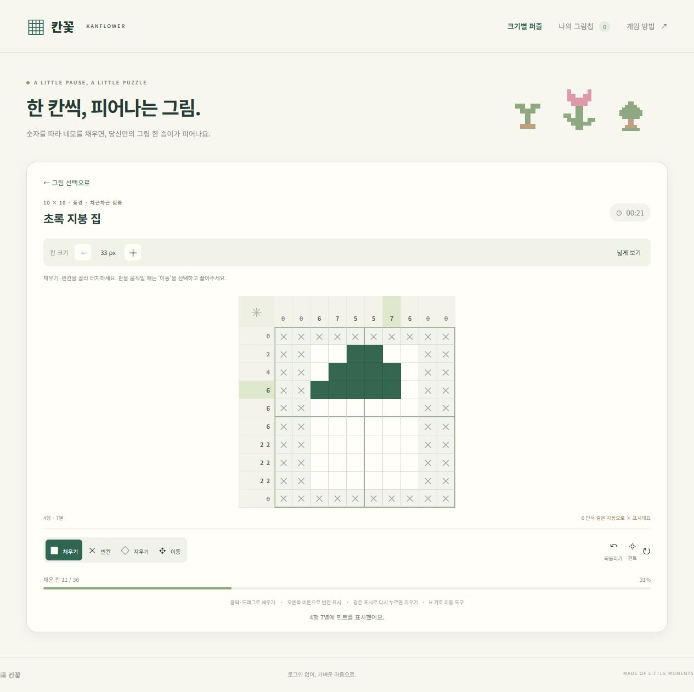

# 칸꽃

숫자 단서를 풀어 픽셀 그림을 완성하는 네모네모로직입니다. 5×5, 10×10, 15×15, 20×20 퍼즐을 제공하며, 풀이 기록은 브라우저와 사이트 주소별로 자동 저장됩니다.

## GitHub Pages에서 플레이

<!-- pages-link:start -->
첫 GitHub Pages 배포가 완료되면 이곳에 게임 실행 링크가 표시됩니다.
<!-- pages-link:end -->

## 게임 스크린샷



*10×10 ‘초록 지붕 집’ 퍼즐을 푸는 모습*

## 게임 조작 방법

PC에서는 마우스로 플레이할 수 있습니다. 왼쪽 버튼으로 클릭하거나 드래그해 칸을 채우고, 오른쪽 버튼으로 빈칸을 표시하세요.

1. 격자 크기를 고르고 풀고 싶은 작품을 선택하세요.
2. 왼쪽 숫자는 가로줄, 위쪽 숫자는 세로줄에서 연속으로 채울 칸 수입니다. 단서가 **2 1**이면 두 칸을 이어서 채우고 한 칸 이상 비운 뒤 한 칸을 채우세요. 단서가 **0**인 줄은 자동으로 빈칸 표시가 됩니다.
3. 모든 가로·세로 단서를 맞추면 컬러 그림이 공개되고 **나의 그림첩**에 추가됩니다.

| 조작 | 사용 방법 |
| --- | --- |
| 칸 채우기 | **채우기**를 선택하고 클릭하거나 드래그하세요. 모바일에서는 칸을 터치하세요. 단축키는 **F**입니다. |
| 빈칸 표시 | 오른쪽 클릭을 하거나 **빈칸** 도구를 선택해 칸을 누르세요. 단축키는 **X**입니다. |
| 표시 지우기 | 같은 표시로 한 번 더 누르거나 **지우기**를 선택하세요. 단축키는 **E**입니다. |
| 판 이동 | **이동** 도구를 선택한 뒤 격자를 끌어 움직이세요. 단축키는 **H**입니다. |
| 키보드로 풀기 | 퍼즐 칸에 초점을 둔 상태에서 **방향키**로 움직이고 **스페이스** 또는 **Enter**로 선택한 도구를 적용하세요. |
| 되돌리기·힌트 | **되돌리기** 또는 **Ctrl+Z**(Mac은 **⌘+Z**)로 마지막 조작을 취소하세요. **힌트**는 잘못 표시한 칸을 고치거나 정답 한 칸을 보여줍니다. |

## 기술 스택

| 기술 | 역할 |
| --- | --- |
| HTML | 게임 화면, 퍼즐 선택, 도움말 구조 |
| CSS | 데스크톱·모바일 화면 배치와 격자 스타일 |
| JavaScript | 퍼즐 조작, 단서 계산, 진행률과 공개 시각 처리, 브라우저 저장 |
| Node.js | 주간 퍼즐 생성과 풀이·공개 일정 검증 |
| GitHub Pages · GitHub Actions | 사이트 호스팅과 예약 생성·배포 |

## 주간 공개

매주 월요일 오전 10시(한국 시각)에 크기별로 한 작품씩, 총 네 작품이 열립니다. 처음 네 주의 작품은 파일에 포함되어 있습니다. 이후에는 GitHub Actions가 내장 픽셀 도안의 형태와 색을 조합해 각 제목과 그림을 함께 만들고, 같은 크기의 기존 격자와 중복되지 않으며 단서만으로 풀리는 작품을 골라 다음 네 주의 대기열을 유지합니다.

공개 날짜와 작품은 `dist/weekly-puzzles.js`에 기록됩니다. 사이트가 예약 시각을 적용하므로 미리 배포된 작품은 당일 작업이 지연되어도 예정 시각에 목록에 표시됩니다. 사이트가 열린 주소의 기존 풀이와 연결되도록 공개된 작품의 ID와 격자를 유지합니다.

## 배포와 자동화

GitHub Pages가 `dist/`의 HTML·CSS·JavaScript를 호스팅합니다. `.github/workflows/pages.yml`은 기본 브랜치에 파일이 올라오거나 월요일 오전 10시(한국 시각)가 되면 실행됩니다. 수동으로도 실행할 수 있습니다.

1. GitHub Actions가 `refill-weekly.cjs`와 `weekly-art.cjs`로 빈 일정을 채웁니다.
2. 새 격자와 공개 규칙, 기존 저장 기록과의 호환성을 검사합니다.
3. 새 작품이 있으면 GitHub가 작업마다 발급하는 기본 토큰으로 작품 파일을 저장소에 기록하고, 같은 실행에서 사이트를 GitHub Pages에 배포합니다.
4. 배포에 성공하면 반환된 GitHub Pages 주소를 README의 게임 실행 링크에 반영합니다.

외부 호스팅, 외부 작업 예약 서비스, 외부 폰트, 별도 API 키나 저장소 비밀 값이 필요하지 않습니다. 내장 도안에는 가능한 조합 수가 있으며, 사용할 도안이 부족해지면 작업 로그에 표시됩니다.

## 로컬 실행 및 검사

`dist/index.html`을 브라우저에서 열어 게임을 실행할 수 있습니다. Node.js가 설치되어 있으면 아래 명령으로 로컬에서 검사할 수 있습니다. `node server.cjs`는 `http://127.0.0.1:4187`에서 사이트를 엽니다.

```sh
node refill-weekly.cjs
node check.cjs
node smoke.cjs
node revision-check.cjs
node report-release-queue.cjs
```
